# Air-Gapped API Security Vulnerability Remediator
### Comprehensive Architectural, Operational, and API Reference Manual

---

## 📑 Table of Contents

1. [Executive Summary & Problem Statement](#1-executive-summary--problem-statement)
2. [High-Level Architecture](#2-high-level-architecture)
3. [Multi-Agent Fleet & Roles](#3-multi-agent-fleet--roles)
   - [BaseAgent Contract & AgentRegistry](#baseagent-contract--agentregistry)
   - [ScannerAgent: Egress & Vulnerability Detection](#scanneragent-egress--vulnerability-detection)
   - [RemediatorAgent: Proxy Configuration & Audit Enforcement](#remediatoragent-proxy-configuration--audit-enforcement)
   - [GitSubAgent: Repository Lifecycle & Air-Gapped Git Support](#gitsubagent-repository-lifecycle--air-gapped-git-support)
4. [The 5-Stage Remediation Pipeline](#4-the-5-stage-remediation-pipeline)
5. [Multi-Agent Control Center Web Dashboard](#5-multi-agent-control-center-web-dashboard)
6. [Complete REST API Specification](#6-complete-rest-api-specification)
7. [Model Context Protocol (MCP) Server](#7-model-context-protocol-mcp-server)
8. [LangGraph & Tool-Calling Integration](#8-langgraph--tool-calling-integration)
9. [Configuration & Deployment](#9-configuration--deployment)
10. [Extensibility Guide: Writing Custom Specialist Agents](#10-extensibility-guide-writing-custom-specialist-agents)
11. [Testing & Quality Assurance](#11-testing--quality-assurance)
12. [Security & Isolation Safeguards](#12-security--isolation-safeguards)

---

## 1. Executive Summary & Problem Statement

### The Air-Gap Challenge
Critical infrastructure, defense systems, banking networks, intelligence platforms, and high-assurance enclaves operate under strict **air-gapped** or **zero-trust isolated network perimeters**. In these perimeters:
- Direct outbound network egress to the public internet is strictly forbidden.
- Third-party cloud API calls, remote telemetry collectors, software analytics beacons, and unvetted CDN requests violate security policy and compliance mandates.
- Repositories and enterprise codebases frequently contain hardcoded outbound HTTP/HTTPS URLs, direct cloud SDK invocations (e.g. AWS, GCP, Azure, Datadog, Sentry), or unconfigured network endpoints that fail or leak sensitive metadata when deployed offline.

### The Solution
The **Air-Gapped API Security Vulnerability Remediator** is an automated, multi-agent remediation system designed to audit, isolate, and remediate unauthorized outbound API egress within air-gapped environments.

Key capabilities include:
1. **Automated Static Egress Auditing**: Recursively discovers outbound network calls, external URLs, and telemetry endpoints across source code and configuration files.
2. **Automated Gateway Redirection & Mocking**: Generates compliant internal proxy configurations (`config/airgap_proxy.json`) routing requests through authorized internal proxies (`proxy.airgap.internal:8080`) with offline mock fallbacks.
3. **Auditing & Compliance Manifests**: Produces formal security manifests (`AIRGAP_SECURITY_AUDIT.md`) documenting all remediated rules and an automated verification checklist.
4. **Air-Gapped Git Operations**: Operates seamlessly against remote repositories (GitHub/GitLab) or completely offline **Local Filesystem Repositories** (`/path/to/repo`), generating offline review manifests (`.git/local_prs/PR-*.md`) without requiring internet access.
5. **Interactive Web Control Center**: A unified dashboard providing step-by-step visibility, real-time diff inspections, custom patch authoring, and one-click end-to-end pipeline execution.
6. **Zero Mandatory External Dependencies**: Built entirely upon the standard Python library (3.9+) to run securely inside restricted environments without requiring `pip install` access to public package mirrors.

---

## 2. High-Level Architecture

The system utilizes an agentic architecture centered around a central orchestrator, a registry of specialized agents, and a unified control layer:

```
                          ┌───────────────────────────────────────────────┐
                          │   Multi-Agent Control Center (Web UI / API)   │
                          │        http://localhost:8080 (web_server.py)  │
                          └───────────────────────┬───────────────────────┘
                                                  │
                                                  ▼
                          ┌───────────────────────────────────────────────┐
                          │     MultiAgentPipeline (Orchestrator)         │
                          └───────┬───────────────┬───────────────┬───────┘
                                  │               │               │
                     Stage 1 & 4  │       Stage 2 │       Stage 3 │
                                  ▼               ▼               ▼
                       ┌──────────────┐   ┌──────────────┐   ┌──────────────┐
                       │ GitSubAgent  │   │ ScannerAgent │   │RemediatorAgnt│
                       └──────┬───────┘   └──────────────┘   └──────────────┘
                              │
            ┌─────────────────┴─────────────────┐
            ▼                                   ▼
┌───────────────────────┐           ┌────────────────────────┐
│  Remote Git Provider  │           │   Local Git Provider   │
│  (GitHub / GitLab)    │           │ (Offline Filesystem)   │
│  - Remote Clone/Push  │           │ - In-Place Worktree    │
│  - Remote Pull Request│           │ - Local PR Manifest    │
└───────────────────────┘           │   (.git/local_prs/)    │
                                    └────────────────────────┘
```

### Core Components
| Component | Source Location | Responsibility |
| :--- | :--- | :--- |
| **`BaseAgent` & `AgentRegistry`** | [`agents/base.py`](file:///Users/krunaldharamshi/Projects/GitAgent/agents/base.py) | Abstract base class, lifecycle states (`READY`, `RUNNING`, `COMPLETED`), and global agent registry. |
| **`ScannerAgent`** | [`agents/scanner_agent/agent.py`](file:///Users/krunaldharamshi/Projects/GitAgent/agents/scanner_agent/agent.py) | Recursive workspace scanner detecting external egress URLs, classification, and severity scoring. |
| **`RemediatorAgent`** | [`agents/remediator_agent/agent.py`](file:///Users/krunaldharamshi/Projects/GitAgent/agents/remediator_agent/agent.py) | Synthesizes `config/airgap_proxy.json` and `AIRGAP_SECURITY_AUDIT.md` compliance manifests. |
| **`GitSubAgent`** | [`agents/git_agent/agent.py`](file:///Users/krunaldharamshi/Projects/GitAgent/agents/git_agent/agent.py) | Clones/opens repositories, provisions feature branches, commits patches, and creates PRs. |
| **`LocalProvider`** | [`agents/git_agent/providers/local.py`](file:///Users/krunaldharamshi/Projects/GitAgent/agents/git_agent/providers/local.py) | Manages offline local repos and generates file-based PR manifests (`.git/local_prs/PR-*.md`). |
| **`MultiAgentPipeline`** | [`orchestrator/pipeline.py`](file:///Users/krunaldharamshi/Projects/GitAgent/orchestrator/pipeline.py) | Coordinates the end-to-end multi-agent execution sequence. |
| **`Web Server & API`** | [`web_server.py`](file:///Users/krunaldharamshi/Projects/GitAgent/web_server.py) | Multi-threaded HTTP server exposing JSON REST endpoints and serving the Web UI. |
| **`Web Dashboard`** | [`web/index.html`](file:///Users/krunaldharamshi/Projects/GitAgent/web/index.html) | Responsive GUI with stage visualization, file diffing, interactive folder browser, and PR modal. |
| **`MCP Server`** | [`agents/git_agent/mcp_server.py`](file:///Users/krunaldharamshi/Projects/GitAgent/agents/git_agent/mcp_server.py) | Model Context Protocol JSON-RPC 2.0 stdio server for LLM hosts (Claude, Cursor, Antigravity). |
| **`LangGraph Adapter`** | [`orchestrator/langgraph_subagent.py`](file:///Users/krunaldharamshi/Projects/GitAgent/orchestrator/langgraph_subagent.py) | Exposes tool functions ready for LangChain/LangGraph `bind_tools()`. |

---

## 3. Multi-Agent Fleet & Roles

### BaseAgent Contract & AgentRegistry
All agents in the ecosystem inherit from [`BaseAgent`](file:///Users/krunaldharamshi/Projects/GitAgent/agents/base.py#L15), ensuring a uniform lifecycle and interface:

```python
class BaseAgent(ABC):
    def __init__(self, name: str, role: str, description: str = ""):
        self.name = name
        self.role = role
        self.description = description
        self.status = "READY"  # READY -> RUNNING -> COMPLETED | ERROR
        self.last_result: Optional[Dict[str, Any]] = None

    @abstractmethod
    def run(self, context: Dict[str, Any]) -> Dict[str, Any]:
        """Execute core task against shared workspace context."""
        pass
```

The [`AgentRegistry`](file:///Users/krunaldharamshi/Projects/GitAgent/agents/base.py#L53) maintains the active fleet:
- `AgentRegistry.register(agent_id, agent)`: Registers an agent instance.
- `AgentRegistry.get(agent_id)`: Fetches an agent by ID.
- `AgentRegistry.list_agents()`: Returns metadata and live statuses for all registered agents, consumed by `/api/agents`.

---

### ScannerAgent: Egress & Vulnerability Detection
[`ScannerAgent`](file:///Users/krunaldharamshi/Projects/GitAgent/agents/scanner_agent/agent.py) is responsible for auditing codebases for outbound network connections:

#### File Ingestion
- Recursively inspects: `.py`, `.js`, `.ts`, `.json`, `.yaml`, `.yml`, `.html`, `.sh`, `.md`, `.txt`, and files starting with `.env`.
- Automatically ignores `.git` internal objects and hidden system directories.

#### Whitelist & Policy Enforcement
URLs are evaluated against an air-gap perimeter policy:
- **Whitelisted targets** (ignored by scanner):
  - `localhost`
  - `127.0.0.1`
  - `*.airgap.internal`
- **Disallowed targets**: Any external public URL scheme (`http://` or `https://`).

#### Rule Taxonomy & Severity Scoring
| Rule ID | Severity | Description | Trigger Condition |
| :--- | :--- | :--- | :--- |
| **`AIRGAP-001`** | **HIGH** | External Egress API Call | Domain contains `api`, `cloud`, `aws`, or `telemetry`. |
| **`AIRGAP-002`** | **MEDIUM** | Direct Internet Route | Outbound URL targeting non-whitelisted external domain without a proxy fallback. |
| **`AIRGAP-003`** | **LOW** | Missing Audit Manifest | Absence of `AIRGAP_SECURITY_AUDIT.md` or perimeter compliance log. |

#### Scanner Output Structure
When executed, `ScannerAgent.run()` returns a structured dictionary:
```json
{
  "agent": "ScannerAgent",
  "status": "completed",
  "total_findings": 2,
  "severity_counts": {
    "critical": 0,
    "high": 1,
    "medium": 1,
    "low": 0
  },
  "findings": [
    {
      "id": "AIRGAP-001",
      "severity": "HIGH",
      "file": "src/api_client.py",
      "line": 42,
      "rule": "External Egress API Call",
      "description": "Outbound egress to 'https://api.external-cloud.com/v1/telemetry' violates isolated air-gap perimeter policy.",
      "recommendation": "Route through internal air-gapped gateway 'http://proxy.airgap.internal:8080' or inject local offline mock."
    }
  ],
  "summary": "Scan completed. Detected 2 air-gapped API & egress issues."
}
```

---

### RemediatorAgent: Proxy Configuration & Audit Enforcement
[`RemediatorAgent`](file:///Users/krunaldharamshi/Projects/GitAgent/agents/remediator_agent/agent.py) resolves detected findings by introducing perimeter gateway interception and formal audit manifests into the repository.

#### 1. Internal Gateway Manifest (`config/airgap_proxy.json`)
Created automatically within the repository workspace:
```json
{
  "airgap_mode": true,
  "proxy_host": "proxy.airgap.internal",
  "proxy_port": 8080,
  "allowed_internal_domains": [
    "*.airgap.internal",
    "localhost",
    "127.0.0.1"
  ],
  "blocked_external_egress": [
    "api.external-cloud.com",
    "telemetry.remote.io"
  ],
  "mock_responses_enabled": true,
  "remediation_status": "COMPLIANT"
}
```

#### 2. Compliance Audit Documentation (`AIRGAP_SECURITY_AUDIT.md`)
Generated at the repository root to verify isolation standards for security review boards:
- **Header**: High Assurance Air-Gap Isolation Status (`REMEDIATED & COMPLIANT`).
- **Remediated Rules**: Explicit mappings for `AIRGAP-001`, `AIRGAP-002`, and `AIRGAP-003`.
- **4-Point Verification Checklist**:
  - `[x]` Zero direct outbound network calls to external public internet
  - `[x]` Internal gateway routing enabled for all required API transactions
  - `[x]` Offline mock fallbacks enabled for disconnected operational state
  - `[x]` Full Git Subagent audit trail generated for peer review

---

### GitSubAgent: Repository Lifecycle & Air-Gapped Git Support
[`GitSubAgent`](file:///Users/krunaldharamshi/Projects/GitAgent/agents/git_agent/agent.py) orchestrates the version control lifecycle before and after remediation.

#### Supported Hosting Modes
1. **GitHub**: API v3 REST integration (supports PR generation, branch detection, draft PRs).
2. **GitLab**: GitLab REST API v4 (supports Merge Requests, self-hosted GitLab Enterprise URLs).
3. **Local Filesystem Repositories & Unlinked Projects** (`ProviderType.LOCAL`):
   - Supports local filesystem paths (e.g. `repos/CustomerApi`, `/home/user/project`, `./repo`, `file:///path/to/repo`).
   - Supports repositories **without any remote upstream** (`origin` unlinked). Changes remain safely committed to the isolated local feature branch without failing on push.
   - Supports **plain local directories** not yet initialized with Git via automated Git repository initialization (`auto_init: true`). Automatically executes `git init`, establishes a baseline commit, and provisions default branches (`main` and `master`).
   - Runs in-place directly on the existing working tree or inside an isolated branch.
   - Detects local default branches (`main`, `master`, or tracking refs).
   - Generates offline Markdown PR manifests (`.git/local_prs/PR-<id>.md` or `.local_prs/PR-<id>.md`).

#### Token Safety & Scrubbing
- Authentication tokens are scrubbed from all terminal logs, exception traces, and subprocess calls via [`GitWorkspace.scrub_text()`](file:///Users/krunaldharamshi/Projects/GitAgent/agents/git_agent/workspace.py#L42).
- When remotes are used, credentials are injected only during ephemeral push commands and never written to `.git/config`.

---

## 4. The 5-Stage Remediation Pipeline

The remediation workflow follows 5 coordinated stages managed by [`MultiAgentPipeline`](file:///Users/krunaldharamshi/Projects/GitAgent/orchestrator/pipeline.py):

```mermaid
sequenceDiagram
    autonumber
    actor User as Security Engineer
    participant Orch as MultiAgentPipeline
    participant Git as GitSubAgent
    participant Scan as ScannerAgent
    participant Rem as RemediatorAgent
    participant Repo as Target Workspace

    User->>Orch: Trigger Pipeline (run_remediation_pipeline)
    
    rect rgb(20, 30, 45)
        note over Git,Repo: STAGE 1: Repository & Workspace Setup
        Orch->>Git: prepare_workspace()
        Git->>Repo: Detect default branch (main/master)
        Git->>Repo: Create feature branch (e.g. airgap/remediate-apis)
        Git-->>Orch: WorkspaceContext (repo_path, feature_branch)
    end

    rect rgb(35, 30, 20)
        note over Scan,Repo: STAGE 2: Egress & Vulnerability Scanning
        Orch->>Scan: run({workspace_path})
        Scan->>Repo: Scan code & configs for outbound URLs
        Scan-->>Orch: findings (AIRGAP-001, AIRGAP-002, AIRGAP-003)
    end

    rect rgb(20, 35, 25)
        note over Rem,Repo: STAGE 3: Automated Remediation
        Orch->>Rem: run({workspace_path})
        Rem->>Repo: Write config/airgap_proxy.json
        Rem->>Repo: Write AIRGAP_SECURITY_AUDIT.md
        Rem-->>Orch: files_modified, report_summary
    end

    rect rgb(25, 20, 35)
        note over Git,Repo: STAGE 4: Commit Fixes
        Orch->>Git: workspace.add() & workspace.commit()
        Git->>Repo: Stage modified files & commit
        Git->>Repo: Push feature branch (remote or local update)
    end

    rect rgb(20, 35, 35)
        note over Git,Repo: STAGE 5: Pull Request Generation
        Orch->>Git: finalize_workspace(pr_title, pr_body)
        Git->>Repo: Create GitHub/GitLab PR or Local PR (.git/local_prs/PR-1.md)
        Git-->>Orch: FinalizeResult (pr_url, commit_hash)
    end

    Orch-->>User: Pipeline Execution Summary (JSON)
```



### Python Programmatic Usage
```python
from agents.git_agent.config import GitAgentConfig, ProviderType
from orchestrator.pipeline import MultiAgentPipeline

# 1. Configure the pipeline for a local or remote repository
config = GitAgentConfig(
    repo_url="/path/to/my-airgapped-service",
    feature_branch_name="airgap/patch-egress-v1",
)

# 2. Instantiate and run
pipeline = MultiAgentPipeline(git_config=config)
result = pipeline.run_remediation_pipeline()

# 3. Inspect results
print(f"Status:      {result['status']}")
print(f"Commit:      {result['git_result']['commit_hash']}")
print(f"PR Review:   {result['git_result']['pr_url']}")
print(f"Total Flaws: {len(result['scan']['findings'])}")
```

---

## 5. Multi-Agent Control Center Web Dashboard

The web dashboard is served directly by `web_server.py` at `http://localhost:8080`.

```bash
# Launch the Multi-Agent Control Center
python3 web_server.py 8080
```

### Dashboard Layout & Features

1. **Connected Agent Fleet Tray**:
   - Dynamically polls `/api/agents` to show all active agents (`GitSubAgent`, `ScannerAgent`, `RemediatorAgent`, or custom registered plugins) with their live statuses.
2. **Interactive 5-Stage Pipeline Cards**:
   - Visual progress indicators reflecting the active execution phase (Setup → Scan → Remediate → Commit → PR).
   - "⚡ Run End-to-End Pipeline" one-click execution button.
3. **Repository Setup & Validation**:
   - **Multi-Target Mode**: Accepts remote URLs (`https://github.com/...`), local Git repositories (including unlinked repos without remotes), or local project folders (`repos/CustomerApi`, `/path/to/project`).
   - **Interactive Folder Browser**: Built-in modal directory browser (`📂 Browse Local Folders...`) with breadcrumb navigation and quick bookmarks (CustomerApi Demo, Home, Workspace, Projects, Documents, Desktop, Downloads).
   - **One-Click Demo Project**: Instant loading button (`💻 Use Demo Project (repos/CustomerApi)`) to test local remediation instantly.
   - **Dynamic Target Mode Badges**: Real-time visual badge updating between `REMOTE GIT REPOSITORY`, `LOCAL REPOSITORY (UNLINKED)`, and `LOCAL DIRECTORY (AUTO-INIT)`.
   - **Real-Time Git Validation**: `/api/validate-path` verifies directory existence, checks `.git` presence, and supports on-demand initialization.
4. **Egress Findings & Vulnerability Viewer**:
   - Interactive table detailing finding IDs, severity tags (HIGH, MEDIUM, LOW), file locations, offending URLs, and recommendations.
5. **In-Browser Patch Editor & Diff Viewer**:
   - Edit any file inside the workspace and save changes directly via `/api/write-file`.
   - Live side-by-side or unified `git diff` output.
6. **Local PR Review Modal**:
   - For local/air-gapped repos, opens an inline modal displaying the generated markdown review manifest (`PR-1.md`) with commit details and status.

---

## 6. Complete REST API Specification

The control server exposes a full REST API for programmatic control and UI integration:

### Endpoint Summary Table
| Method | Endpoint | Description |
| :--- | :--- | :--- |
| `GET` | `/` or `/index.html` | Serves the single-page Multi-Agent Control Center HTML application. |
| `GET` | `/api/agents` | Lists all registered agents and their current statuses. |
| `GET` | `/api/status` | Returns the active repository's git status (branch, modified files, untracked files). |
| `GET` | `/api/diff` | Returns the current workspace git diff. |
| `GET` | `/api/local-pr` | Fetches the generated local PR markdown review document. |
| `POST` | `/api/prepare` | Prepares the workspace (clones remote, mounts local repo, or auto-inits local project). |
| `POST` | `/api/scan` | Runs `ScannerAgent` across the prepared workspace. |
| `POST` | `/api/fix` | Runs `RemediatorAgent` to apply proxy configs and audit manifests. |
| `POST` | `/api/write-file` | Writes or edits a file inside the repository workspace. |
| `POST` | `/api/commit-push` | Stages changes, creates a git commit, and updates the branch. |
| `POST` | `/api/create-pr` | Creates a Pull Request on GitHub/GitLab or generates a Local PR manifest. |
| `POST` | `/api/pipeline/run` | Executes the complete 5-stage remediation pipeline sequentially. |
| `POST` | `/api/validate-path` | Validates directory existence, checks `.git` presence, and supports auto-init. |
| `POST` | `/api/fs/list` | Lists subdirectories for the interactive UI folder picker. |

---

### Detailed Endpoint Documentation

#### 1. `GET /api/agents`
Returns all registered agents in the `AgentRegistry`.

**Response (200 OK):**
```json
{
  "agents": [
    {
      "id": "git",
      "name": "GitSubAgent",
      "role": "Repository Lifecycle & PR Specialist",
      "description": "Manages git repository provisioning, feature branching, atomic commits, and pull requests.",
      "status": "READY",
      "has_result": false
    },
    {
      "id": "scanner",
      "name": "ScannerAgent",
      "role": "Air-Gap Egress & Security Scanner",
      "description": "Audits codebase for outbound network requests, external APIs, and air-gap policy violations.",
      "status": "READY",
      "has_result": false
    },
    {
      "id": "remediator",
      "name": "RemediatorAgent",
      "role": "Air-Gap Remediation & Patch Specialist",
      "description": "Applies automated fixes, configures internal gateway proxies, and produces audit manifests.",
      "status": "READY",
      "has_result": false
    }
  ],
  "total": 3
}
```

---

#### 2. `POST /api/prepare`
Initializes a repository workspace, checks out a feature branch, and optionally auto-initializes plain directories into Git repositories.

**Request Body:**
```json
{
  "repo_url": "/path/to/my-repo",
  "token": "optional_token_for_remote",
  "provider": "local",
  "base_branch": "main",
  "feature_branch": "agent/audit-fix-01",
  "workspace_dir": null,
  "author_name": "Security Bot",
  "author_email": "bot@airgap.local",
  "auto_init": true
}
```

**Response (200 OK):**
```json
{
  "message": "Repository prepared successfully",
  "context": {
    "repo_path": "/path/to/my-repo",
    "base_branch": "main",
    "feature_branch": "agent/audit-fix-01",
    "provider": "local",
    "repo_url": "/path/to/my-repo",
    "metadata": {}
  },
  "status": {
    "branch": "agent/audit-fix-01",
    "clean": true,
    "modified_files": [],
    "untracked_files": []
  }
}
```

---

#### 3. `POST /api/scan`
Triggers `ScannerAgent` to scan the prepared workspace for external network egress.

**Response (200 OK):**
```json
{
  "agent": "ScannerAgent",
  "status": "completed",
  "mode": "live",
  "total_findings": 3,
  "severity_counts": {
    "critical": 0,
    "high": 1,
    "medium": 1,
    "low": 1
  },
  "findings": [
    {
      "id": "AIRGAP-001",
      "severity": "HIGH",
      "file": "src/api_client.py",
      "line": 42,
      "rule": "External Egress API Call",
      "description": "Outbound egress to 'https://api.external-cloud.com/v1/telemetry' violates isolated air-gap perimeter policy.",
      "recommendation": "Route through internal air-gapped gateway 'http://proxy.airgap.internal:8080' or inject local offline mock."
    }
  ],
  "summary": "Scan completed. Detected 3 air-gapped API & egress issues."
}
```

---

#### 4. `POST /api/fix`
Triggers `RemediatorAgent` to write `config/airgap_proxy.json` and `AIRGAP_SECURITY_AUDIT.md`.

**Response (200 OK):**
```json
{
  "agent": "RemediatorAgent",
  "status": "completed",
  "mode": "live",
  "files_modified": [
    "config/airgap_proxy.json",
    "AIRGAP_SECURITY_AUDIT.md"
  ],
  "summary": "Configured internal airgap gateway proxy and generated audit report.",
  "report_summary": "# Air-Gapped API Remediation Audit Report...",
  "status_summary": {
    "branch": "agent/audit-fix-01",
    "clean": false,
    "modified_files": [],
    "untracked_files": [
      "AIRGAP_SECURITY_AUDIT.md",
      "config/airgap_proxy.json"
    ]
  },
  "diff": ""
}
```

---

#### 5. `POST /api/write-file`
Writes or updates arbitrary files within the workspace sandbox.

**Request Body:**
```json
{
  "relative_path": "src/api_client.py",
  "content": "PROXY = 'http://proxy.airgap.internal:8080'\n..."
}
```

**Security Validation**: If `relative_path` resolves to a location outside the repository workspace root, the API responds with `403 Forbidden` (`{"error": "Forbidden path outside workspace"}`).

---

#### 6. `POST /api/commit-push`
Stages modified files, authors a git commit, and updates the branch.

**Request Body:**
```json
{
  "commit_message": "fix(airgap): redirect external API calls to internal proxy",
  "files": null
}
```

**Response (200 OK):**
```json
{
  "message": "Committed 8f2a1b9 and updated local branch 'agent/audit-fix-01'",
  "commit_hash": "8f2a1b9c3e4d5f6a7b8c9d0e1f2a3b4c5d6e7f8a",
  "branch": "agent/audit-fix-01"
}
```

---

#### 7. `POST /api/create-pr`
Generates a Pull Request or offline Local PR review manifest.

**Request Body:**
```json
{
  "title": "[Air-Gapped Remediation] Replace external API egress with offline services",
  "description": "Automated Pull Request from Multi-Agent System",
  "draft": false
}
```

**Response (200 OK for Local Repository):**
```json
{
  "message": "Local Pull Request created successfully",
  "pr_number": 1,
  "pr_url": "file:///path/to/my-repo/.git/local_prs/PR-1.md",
  "pr_file_path": "/path/to/my-repo/.git/local_prs/PR-1.md",
  "pr_content": "# Pull Request #1: [Air-Gapped Remediation]...",
  "title": "[Air-Gapped Remediation] Replace external API egress with offline services",
  "provider": "local"
}
```

---

#### 8. `POST /api/pipeline/run`
Executes all 5 stages in an end-to-end atomic workflow.

**Response (200 OK):**
```json
{
  "status": "success",
  "context": {
    "repo_path": "/path/to/my-repo",
    "base_branch": "main",
    "feature_branch": "agent/vuln-audit-20261105-152219",
    "provider": "local",
    "repo_url": "/path/to/my-repo"
  },
  "scan": { "findings": [...] },
  "remediation": { "files_modified": [...] },
  "git_result": {
    "status": "success",
    "commit_hash": "8f2a1b9...",
    "pr_url": "file:///path/to/my-repo/.git/local_prs/PR-1.md",
    "pr_number": 1
  }
}
```

---

#### 9. `POST /api/validate-path`
Validates directory existence and `.git` repository health before workspace preparation. When `allow_non_git: true` is passed, accepts non-git directories and signals auto-init readiness. When `auto_init: true` is passed, initializes git in-place.

**Request Body:**
```json
{
  "path": "/Users/developer/Projects/payment-gateway",
  "allow_non_git": true,
  "auto_init": false
}
```

**Response (200 OK - Git Repository):**
```json
{
  "valid": true,
  "exists": true,
  "is_dir": true,
  "has_git": true,
  "can_auto_init": false,
  "path": "/Users/developer/Projects/payment-gateway",
  "message": "Valid Git repository detected at /Users/developer/Projects/payment-gateway"
}
```

**Response (200 OK - Plain Directory with `allow_non_git: true`):**
```json
{
  "valid": true,
  "exists": true,
  "is_dir": true,
  "has_git": false,
  "can_auto_init": true,
  "path": "/Users/developer/Projects/plain-folder",
  "message": "Local directory detected (Git repository can be auto-initialized)"
}
```

**Error Response (400 Bad Request when not a git repo and `allow_non_git: false`):**
```json
{
  "valid": false,
  "exists": true,
  "is_dir": true,
  "has_git": false,
  "can_auto_init": true,
  "path": "/Users/developer/Projects/plain-folder",
  "error": "Selected path '/Users/developer/Projects/plain-folder' is not a Git repository (missing '.git' directory). Pass 'allow_non_git': true to allow auto-initialization."
}
```

---

#### 10. `POST /api/fs/list`
Powers the interactive directory browser in the Web UI.

**Request Body:**
```json
{
  "path": "/Users/developer/Projects"
}
```

**Response (200 OK):**
```json
{
  "current_path": "/Users/developer/Projects",
  "current_has_git": false,
  "parent_path": "/Users/developer",
  "folders": [
    {
      "name": "payment-gateway",
      "path": "/Users/developer/Projects/payment-gateway",
      "has_git": true
    },
    {
      "name": "auth-service",
      "path": "/Users/developer/Projects/auth-service",
      "has_git": true
    }
  ],
  "quick_access": [
    { "label": "🏠 Home", "path": "/Users/developer" },
    { "label": "📁 Workspace", "path": "/Users/developer/Projects/GitAgent" },
    { "label": "Projects", "path": "/Users/developer/Projects" }
  ]
}
```

---

## 7. Model Context Protocol (MCP) Server

The remediator includes an MCP stdio server compliant with the official Model Context Protocol (2024-11-05 specification). Any MCP-compliant AI client (Anthropic Claude Desktop, Cursor, Antigravity) can directly command the Git agent.

### Starting the MCP Server
```bash
python3 -m agents.git_agent.mcp_server
# Or using the package CLI entry point:
git-agent mcp
```

### Host Configuration (`claude_desktop_config.json` or Antigravity Settings)
```json
{
  "mcpServers": {
    "git-remediator": {
      "command": "python3",
      "args": ["-m", "agents.git_agent.mcp_server"],
      "cwd": "/path/to/GitAgent",
      "env": {
        "GITHUB_TOKEN": "ghp_xxxxxxxxxxxx",
        "GITLAB_TOKEN": "glpat-xxxxxxxxxxxx"
      }
    }
  }
}
```

### Exposed MCP Tools
1. `git_prepare_repo`: Prepares remote clone or opens local repository and switches to feature branch.
2. `git_status`: Returns current working tree status and branch info.
3. `git_diff`: Returns unstaged or staged diffs.
4. `git_read_file`: Reads file content from repository for inspection.
5. `git_write_file`: Writes/patches file content within the workspace.
6. `git_commit_and_push`: Stages files, commits with author attribution, and updates branch.
7. `git_create_pull_request`: Raises PR/MR or creates Local PR manifest.
8. `git_finalize_audit`: One-step action staging, committing, and opening PR/MR.

---

## 8. LangGraph & Tool-Calling Integration

To orchestrate `GitSubAgent` within LangGraph or ReAct agent loops, use the adapter functions provided in [`orchestrator/langgraph_subagent.py`](file:///Users/krunaldharamshi/Projects/GitAgent/orchestrator/langgraph_subagent.py):

```python
from agents.git_agent.config import GitAgentConfig
from orchestrator.langgraph_subagent import create_git_subagent_tools

config = GitAgentConfig(
    repo_url="/path/to/airgapped-service",
    feature_branch_prefix="agent/audit-",
)

# Returns standard Python tool functions
tools = create_git_subagent_tools(config)

# Bind directly to LangChain / LangGraph LLM:
# llm_with_tools = model.bind_tools(tools)
```

The tools exposed include:
- `git_prepare_workspace(feature_branch=None)`
- `git_check_status()`
- `git_finalize_and_open_pr(commit_message, pr_title, pr_description)`

---

## 9. Configuration & Deployment

### Environment Variables
Configure token credentials without committing secrets:
```bash
# GitHub Personal Access Token
export GITHUB_TOKEN="ghp_yourTokenHere"

# GitLab Personal Access Token
export GITLAB_TOKEN="glpat-yourTokenHere"

# Generic Git Agent Token
export GIT_AGENT_TOKEN="yourTokenHere"
```
*(Note: Tokens are completely optional when auditing local filesystem repositories).*

### YAML Configuration File (`git_agent_config.example.yaml`)
```yaml
repo_url: "https://github.com/my-org/core-service.git" # Or "/path/to/local/project"
token: "ghp_xxxxxxxxxxxxxxxxxxxx"
provider: "github" # "github", "gitlab", or "local" (auto-detected if omitted)
base_branch: "main" # "main", "master", or null for auto-detection
feature_branch_prefix: "airgap/audit-"
author_name: "AirGap Remediator Agent"
author_email: "secagent@airgap.local"
default_pr_title: "[Air-Gap Security] Automated egress remediation"
draft_pr: false
```

---

## 10. Extensibility Guide: Writing Custom Specialist Agents

The multi-agent architecture allows teams to add custom auditing or patching agents (e.g. AST syntax checkers, SBOM generators, Dockerfile inspectors).

### Example: Creating a Perimeter Compliance Agent
Create a new agent file (e.g., `agents/custom_policy_agent.py`):

```python
from agents.base import BaseAgent, AgentRegistry
from typing import Dict, Any
from pathlib import Path

class PolicyComplianceAgent(BaseAgent):
    def __init__(self):
        super().__init__(
            name="PolicyComplianceAgent",
            role="Regulatory Perimeter Auditor",
            description="Verifies that no unencrypted telemetry collectors are present."
        )

    def run(self, context: Dict[str, Any]) -> Dict[str, Any]:
        self.status = "RUNNING"
        ws_path = Path(context.get("workspace_path", "."))
        
        # Custom inspection logic...
        findings = []
        # Populate findings...

        result = {
            "agent": self.name,
            "status": "completed",
            "findings": findings,
            "passed": len(findings) == 0,
        }
        self.last_result = result
        self.status = "COMPLETED"
        return result

# Register in the fleet
AgentRegistry.register("policy", PolicyComplianceAgent())
```

Once registered, the new agent:
1. Is instantly discoverable in `GET /api/agents`.
2. Appears dynamically in the **Connected Agent Fleet** tray in the Web UI.
3. Can be incorporated into customized pipelines.

---

## 11. Testing & Quality Assurance

The codebase includes an exhaustive test suite of **69 automated unit and integration tests** covering all agents, providers, workspaces, web endpoints, and unlinked/offline repositories.

### Executing the Test Suite
Run the standard library test runner:
```bash
python3 -m unittest discover -s tests
```

### Test Coverage Highlights
- [`tests/test_multi_agent.py`](file:///Users/krunaldharamshi/Projects/GitAgent/tests/test_multi_agent.py): Tests `AgentRegistry`, `ScannerAgent` detection of external URLs, `RemediatorAgent` generation of proxy configs, and `MultiAgentPipeline` execution on local git repositories.
- [`tests/test_web_server.py`](file:///Users/krunaldharamshi/Projects/GitAgent/tests/test_web_server.py): Tests all web API endpoints (`/api/validate-path`, `/api/prepare`, `/api/scan`, `/api/fix`, `/api/local-pr`, `/api/fs/list`), including non-git validation (`allow_non_git`), auto-initialization (`auto_init`), and end-to-end remediation of unlinked local projects without remotes.
- [`tests/test_providers.py`](file:///Users/krunaldharamshi/Projects/GitAgent/tests/test_providers.py): Tests GitHub, GitLab, and `LocalProvider` repository access verification, branch detection, auto-initialization of git repos, and local PR manifest creation.
- [`tests/test_mcp_server.py`](file:///Users/krunaldharamshi/Projects/GitAgent/tests/test_mcp_server.py): Validates JSON-RPC 2.0 MCP tools, dispatching, and error handling.
- [`tests/test_workspace.py`](file:///Users/krunaldharamshi/Projects/GitAgent/tests/test_workspace.py): Tests isolated temporary workspaces, git diffing, staging, committing, and token scrubbing.

---

## 12. Security & Isolation Safeguards

1. **Zero External Runtime Dependencies**:
   The entire system relies solely on the Python 3.9+ standard library (`http.server`, `urllib`, `subprocess`, `json`, `re`, `pathlib`). No external package installations are required, mitigating supply-chain attack vectors.
2. **Path Traversal Protection**:
   The `/api/write-file` endpoint validates that all file write requests resolve strictly within the target repository workspace root directory, preventing arbitrary filesystem writes.
3. **Sensitive Credential Sanitization**:
   All tokens are masked during execution and scrubbed from error logs, standard output, and git remotes.
4. **Local Isolation Mode**:
   When auditing local repositories, all git transactions are contained locally on disk, and review manifests are placed directly in `.git/local_prs/` without emitting any network packets.

---
*Generated according to the GitAgent multi-agent codebase specification.*

